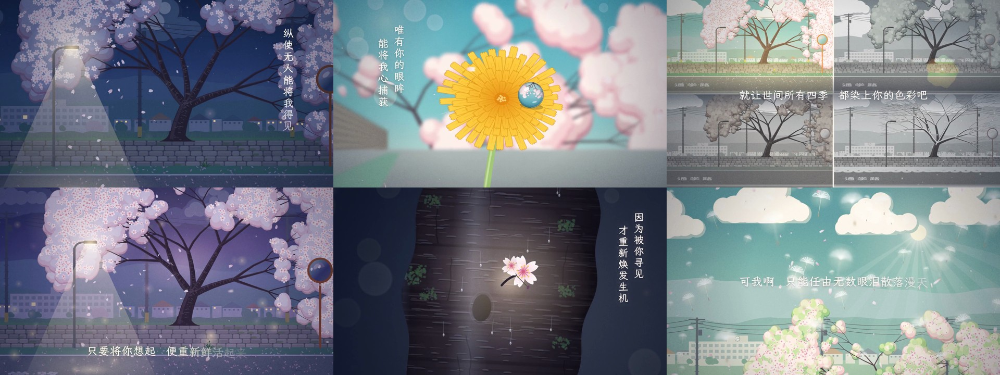

# 「桜の目にも涙」 — a music video with no one in it

Fan music video for **「桜の目にも涙」 by 冬館**, with Chinese lyrics.
There are no people anywhere in it. The story is carried by a cherry tree and a dandelion.



## Download

| Version | Size | Where |
|---|---|---|
| **1080p** (1920×1080, 30 fps) | ~165 MB | [Releases → sakura-mv-v1](https://github.com/Fengli-ruomeng/MyFileStroage/releases/tag/sakura-mv-v1) (too big for a normal repo file; GitHub's limit is 100 MB) |
| **720p** (1280×720, 30 fps) | ~40 MB | [`sakura-no-me-nimo-namida_MV_720p.mp4`](sakura-no-me-nimo-namida_MV_720p.mp4) in this folder, and also in the release |

Release downloads are plain HTTPS files, so a download manager can resume them if the connection drops.

## The story

* **私 is the cherry tree** on the school road (通学路). Its falling petals are the "countless tears" (无数眼泪散落漫天).
* **君 is a dandelion** blooming unnoticed in a crack at the foot of the stone wall (人知れず咲き匂う). Its life cycle carries the lyrics:
  * it blooms (降生于世)
  * it closes at night and opens at sunrise (救赎)
  * it turns into a seed head as their time runs out (相遇的时光正在不断地减少)
  * its seeds fly off into the sky (想知道遥远未来的你)
  * new dandelions bloom along the wall the next spring (来世仍能共赴这场春日)

| Time | Lyric | Shot |
|---|---|---|
| 0:00 | 纵使无人能将我得见 | An empty school road at night; the lamplit tree scatters its petals |
| 0:10 | (intro) | The sky shifts from night to dawn; title |
| 0:25 | 我邂逅了悄然绽放的你 | The dandelion blooms at the wall's foot |
| 0:30 | 唯有你的眼眸 能将我心捕获 | Push-in to a dewdrop on the flower, with the tree reflected upside-down inside it |
| 0:35 | 眼底藏着一丝落寞 是与我如此地相像 | Split screen: the lone tree and the lone dandelion |
| 0:45 | 就让世间所有四季 都染上你的色彩吧 | Four grey season panels flood with the dandelion's gold |
| 0:50 | 空虚到泫然欲泣的夜晚 / 便重新鲜活起来 | An empty lamplit night turns vivid |
| 1:00 | 还想再见 / 降生于世 便是对我的救赎 | The dandelion, closed at night, opens with the sunrise |
| 1:15 | 四季都染上你的色彩 | The tree cycles through all four seasons in gold light |
| 1:20 | (instrumental) | Time-lapse days; the school clock spinning |
| 1:31 | 任凭祈求时间停驻的我… | A 「止まれ」 (stop) road marking, taken from the Japanese line 止まれ時よ, while days and petals rush past |
| 1:36 | 能与你相遇的时光 正在不断地减少 | Petals letting go one by one |
| 1:45 | 若要夺走什么 就只管把我带走啊 | A storm strips the tree while the dandelion's seed head survives underneath |
| 1:50 | 本只会逐渐腐朽的心灵… 才重新焕发生机 | A single blossom sprouts from the old trunk (胴吹き) |
| 2:30 | 我好想知道 遥远未来的你 | The seeds take off into the sky |
| 2:40 | (instrumental) | Over the town; summer → autumn → winter, with the tree alone |
| 3:00 | 我会连带你的那一份 一起活下去 / 愿来世… | Spring returns with a row of new dandelions at the tree's feet |

## How it was made

Everything is drawn procedurally on an HTML `<canvas>`: the tree, dandelion, sky, town, particles and lyrics. Each frame is a deterministic function of time `t`, rendered headlessly with Playwright and encoded with ffmpeg. The tempo and loudness analysis in `source/audio.js` came from librosa.

* Style follows the single's cover art: teal sky, pale sakura pink, paper grain
* Lyrics font: [LXGW WenKai / 霞鹜文楷](https://github.com/lxgw/LxgwWenKai) (OFL)
* Road markings: Noto Sans CJK

### Re-rendering

The song file is **not** included. Put your own copy next to `index.html` as `song.mp3`.

```bash
cd source
npm install            # LXGW WenKai webfont
npm install playwright # if not installed; also needs Chromium: npx playwright install chromium
# preview a few frames
node render.js stills 15,33,56,118,188 ./stills
# full video in two halves (30 fps, 5813 frames), then join and add the audio
node render.js video 0 2906 partA.mp4
node render.js video 2906 5813 partB.mp4
printf "file 'partA.mp4'\nfile 'partB.mp4'\n" > list.txt
ffmpeg -f concat -safe 0 -i list.txt -i song.mp3 -map 0:v -map 1:a -c:v copy -c:a aac -b:a 256k -shortest out.mp4
```

You can also open `index.html?t=56` in a browser to see a single frame.

The shot timeline lives in `source/js/shots.js` and the lyrics with their timings and positions in `source/js/lyrics.js`.

## Credits

* Song: 「桜の目にも涙」 — 冬館. All rights to the song belong to its creators. This is a non-commercial fan work.
* Chinese lyrics timeline (LRC): Res_Ty
